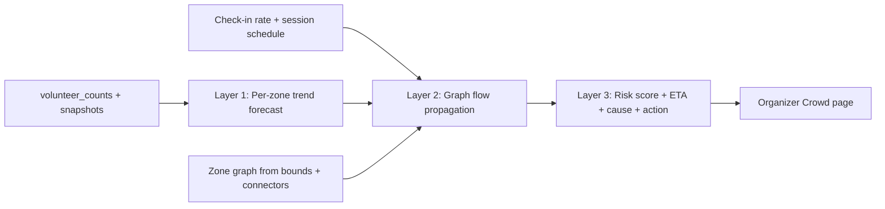

# Overcrowding Prediction: Algorithmic Approach (Organizer Dashboard Only)

## Goal
Warn organizers **5–20 minutes before** a zone crosses its warning or critical threshold. It should also say **why** and **what to do**. It uses no ML, only the zone graph and the live data we already collect.

## What the codebase already gives us

| Need | Existing asset |
|---|---|
| Live occupancy | `volunteer_counts.active_count` (overwritten each flush, so **no history**) |
| History | `crowd_zone_snapshots (zone_id, estimated_count, snapshot_at)`. It is only written by manual calibration today. |
| Capacity and thresholds | `event_zones.operating_capacity`, `capacity_limit`, `warning_threshold` (0.80), `critical_threshold` (0.90), `is_crowd_monitored` |
| "Nodes" (spatial) | `venue_zones.bounds` (normalized rectangle), `entrance_point`, `level_id`. Vertical connectors (elevator/stairs) are `venue_pois` with `connected_level_indices` in metadata. |
| Inflow signal | `tickets.check_in_at` and `checked_in_zone` (gate arrival rate) |
| Schedule signal | Session schedules (start/end/zone), which are time-aware per Phase 7C |
| UI home | [OrganizerCrowd.jsx](file:///c:/Users/blais/Desktop/Full-Stack-Projects/spatially/client/src/pages/OrganizerCrowd.jsx) polls `/api/organizer/crowd/{id}` every 10s. Backend: [organizer.py](file:///c:/Users/blais/Desktop/Full-Stack-Projects/spatially/server/routes/organizer.py#L520-L549). |

> [!IMPORTANT]
> There is **no explicit node/edge (adjacency) table**. The zone graph has to be built. Adjacency can be **derived automatically** from `bounds` (rectangles that touch or overlap) and level connectors. Organizers can optionally override it.

## Recommended approach: 3-layer deterministic predictor



### Layer 1: Per-zone short-term forecast
- Occupancy ratio `r = count / operating_capacity` (fall back to `capacity_limit`).
- Smooth the counts with **Holt's double exponential smoothing** (level + trend) over a rolling 10–15 min window of snapshots. Alternative: a linear regression slope over the last N points.
- `ETA = (warning_threshold × cap − level) / trend` when trend > 0.
- This layer alone catches "this zone is filling fast".

### Layer 2: Graph flow propagation (uses the node structure)
- Build the graph: nodes = zones, edges = adjacent zones (touching bounds, same level) plus connector links across levels. Weight edges by shared border length or distance between `entrance_point`s.
- **Pressure from neighbours:** when an upstream zone is near its limit or rising, a fraction flows downstream.
  `projected_i(t+h) = forecast_i + Σ_j w_ji · outflow_j · (headroom_i / Σ_k headroom_k)`
  Outflow is split across neighbours in proportion to free capacity, so full zones attract less.
- **Gate inflow:** a check-in rate from `tickets` is injected at the entrance zones.
- **Scheduled surges:** a session ending in zone Z at time T injects a dispersal pulse (≈ Z occupancy) to Z's neighbours over the next few minutes. A session starting does the same toward the session zone.
- Cap propagation at 1–2 hops with a decay factor. This keeps it explainable.

### Layer 3: Risk output
Per zone return:
```json
{ "zone_id": "...", "risk": "watch|warning|critical",
  "projected_ratio_15m": 0.93, "eta_minutes": 8,
  "confidence": 0.7, "drivers": ["trend +12/min", "inflow from Hall A", "Keynote ends 14:30"],
  "suggested_action": "Redirect Gate B traffic; dispatch 2 volunteers from Zone C" }
```
`confidence` comes from data freshness and the number of scanners. Stale data gives "low confidence" instead of a false alarm.

## Proposed changes (post-approval)

#### [NEW] `server/services/crowd_prediction.py`
Pure functions: `build_zone_graph`, `holt_forecast`, `propagate_pressure`, `score_zones`. Unit-testable with no DB.

#### [MODIFY] [organizer.py](file:///c:/Users/blais/Desktop/Full-Stack-Projects/spatially/server/routes/organizer.py)
Add `GET /api/organizer/crowd/{event_id}/predictions?horizon=15`. It is organizer-only via `require_organizer` and `verify_event_ownership`. It reads counts, snapshots, zones, check-ins and sessions.

#### [NEW] Snapshot recorder
Make `crowd_zone_snapshots` populate automatically, since history is the main data gap. Either a throttled write inside the existing crowd endpoint (at most 1 snapshot per zone per minute) or a Supabase `pg_cron` job. Prune old rows after the event.

#### [MODIFY] `OrganizerCrowd.jsx`
Add a "Predicted overcrowding" panel: ranked at-risk zones, ETA chips, drivers, suggested action, and a projected-ratio sparkline. Optional "Create task / broadcast" shortcut reuses the existing tasks and comms flows. Reuse the 10s poll.

#### [OPTIONAL][NEW] `zone_links` table
`(event_id, zone_a, zone_b, weight, is_override)` for organizer-adjusted adjacency. Skip for v1 and rely on auto-derivation.

## Verification
- **Unit tests** (`server/tests`): synthetic ramp, plateau and dispersal scenarios. They check the ETA, that propagation conserves mass, and that stale data lowers confidence.
- **Replay seed:** insert simulated snapshots for the seeded event and check the dashboard output.
- **Manual:** open Organizer → Crowd and confirm the at-risk panel moves as counts change.

## Open questions

> [!IMPORTANT]
> 1. **Adjacency:** derive it automatically from `bounds` (recommended for v1), or add an organizer-editable `zone_links` table now?
> 2. **Scope:** Layer 1 only (fast, simple), or all three layers including schedule-driven surges? I recommend building all three in order, shipping Layer 1 first.
> 3. **History:** OK to auto-write `crowd_zone_snapshots` every minute? Without it there is no trend to predict from.
> 4. **Actions:** should the dashboard only *suggest* actions, or also offer one-click broadcast/task creation?
